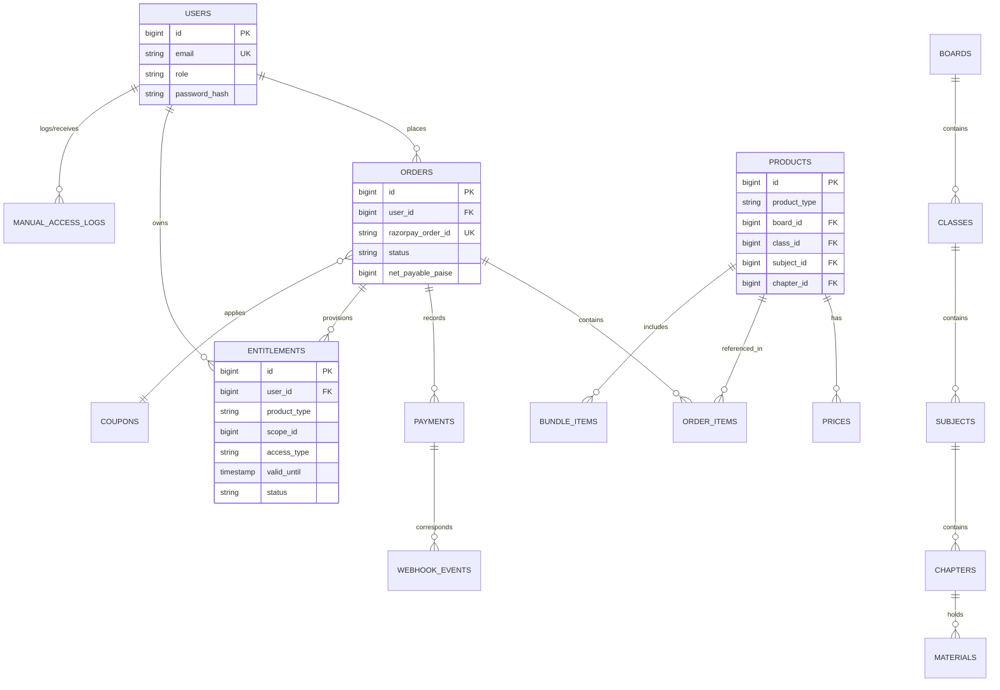

# 03. System Architecture & Database Design

This document details the architectural layers, system security boundaries, relational schema specifications, and the Entity-Relationship (ER) diagram.

---

## 🏗️ 1. Technical Architecture Overview

```
┌────────────────────────────────────────────────────────┐
│                   React.js + TypeScript                │
│       (Student Catalog, Cart, Reader, Admin UI)        │
└──────────────────────────┬─────────────────────────────┘
                           │ HTTPS (REST API / JSON)
                           ▼
┌────────────────────────────────────────────────────────┐
│              Django REST Framework (DRF)               │
│  ┌──────────────────────────────────────────────────┐  │
│  │ Middlewares: Auth (JWT/Cookie), Rate Limiting    │  │
│  ├──────────────────────────────────────────────────┤  │
│  │ Business Logic: Pricing, Upgrades, GST Engine    │  │
│  ├──────────────────────────────────────────────────┤  │
│  │ Payment Service: Razorpay HMAC-SHA256 & Webhook │  │
│  ├──────────────────────────────────────────────────┤  │
│  │ Entitlement Service: Grant, Verify, Expire       │  │
│  ├──────────────────────────────────────────────────┤  │
│  │ Protected Content Service: PDF Streaming/Tokens │  │
│  └──────────────────────────────────────────────────┘  │
└──────────────────────────┬─────────────────────────────┘
                           │ Django ORM
                           ▼
┌────────────────────────────────────────────────────────┐
│                   MySQL 8.0 Database                   │
│       (Relational integrity, Foreign Keys, ACID)       │
└────────────────────────────────────────────────────────┘
```

---

## 🗄️ 2. Database Schema (14 Mandatory Tables + 2 Supporting Tables)

### Mandatory Tables

#### 1. `users`
- `id` (PK, BigInt, Auto-increment)
- `email` (Varchar(255), Unique, Indexed)
- `password_hash` (Varchar(255), Argon2/bcrypt)
- `full_name` (Varchar(100))
- `phone_number` (Varchar(20), Nullable)
- `role` (Enum: `'STUDENT'`, `'ADMIN'`, Default: `'STUDENT'`)
- `is_active` (Boolean, Default: True)
- `created_at`, `updated_at` (Timestamps)

#### 2. `boards`
- `id` (PK, BigInt)
- `name` (Varchar(100), e.g., 'CBSE', 'ICSE')
- `slug` (Varchar(100), Unique)
- `description` (Text, Nullable)
- `created_at`, `updated_at`

#### 3. `classes`
- `id` (PK, BigInt)
- `board_id` (FK -> `boards.id`, On Delete Cascade)
- `name` (Varchar(50), e.g., 'Class 10')
- `slug` (Varchar(50))
- `created_at`, `updated_at`

#### 4. `subjects`
- `id` (PK, BigInt)
- `class_id` (FK -> `classes.id`, On Delete Cascade)
- `name` (Varchar(100), e.g., 'Mathematics')
- `slug` (Varchar(100))
- `thumbnail_url` (Varchar(255), Nullable)
- `created_at`, `updated_at`

#### 5. `chapters`
- `id` (PK, BigInt)
- `subject_id` (FK -> `subjects.id`, On Delete Cascade)
- `chapter_number` (Int)
- `title` (Varchar(200))
- `slug` (Varchar(200))
- `is_free_sample` (Boolean, Default: False)
- `created_at`, `updated_at`

#### 6. `materials`
- `id` (PK, BigInt)
- `chapter_id` (FK -> `chapters.id`, On Delete Cascade)
- `title` (Varchar(200))
- `file_path` (Varchar(500), Internal storage path, never exposed publicly)
- `file_size_bytes` (BigInt)
- `mime_type` (Varchar(50), e.g., 'application/pdf')
- `created_at`, `updated_at`

#### 7. `products`
- `id` (PK, BigInt)
- `title` (Varchar(200))
- `product_type` (Enum: `'CHAPTER_NOTES'`, `'SUBJECT_PACK'`, `'MONTHLY_PASS'`, `'ANNUAL_PASS'`, `'BUNDLE'`, `'FREE_SAMPLE'`)
- `board_id` (FK -> `boards.id`, Nullable)
- `class_id` (FK -> `classes.id`, Nullable)
- `subject_id` (FK -> `subjects.id`, Nullable)
- `chapter_id` (FK -> `chapters.id`, Nullable)
- `is_active` (Boolean, Default: True)
- `created_at`, `updated_at`

#### 8. `prices`
- `id` (PK, BigInt)
- `product_id` (FK -> `products.id`, On Delete Cascade)
- `amount_paise` (BigInt, e.g., 49900 for ₹499.00)
- `currency` (Varchar(3), Default: 'INR')
- `valid_from` (Timestamp)
- `valid_until` (Timestamp, Nullable)
- `is_current` (Boolean, Default: True)

#### 9. `coupons`
- `id` (PK, BigInt)
- `code` (Varchar(50), Unique, Indexed)
- `discount_type` (Enum: `'FLAT'`, `'PERCENTAGE'`)
- `discount_value` (BigInt, Paise if FLAT, basis points or % if PERCENTAGE)
- `min_order_paise` (BigInt, Default: 0)
- `max_discount_paise` (BigInt, Nullable)
- `usage_limit` (Int, Default: 100)
- `times_used` (Int, Default: 0)
- `valid_from` (Timestamp)
- `valid_until` (Timestamp)
- `is_active` (Boolean, Default: True)

#### 10. `orders`
- `id` (PK, BigInt)
- `user_id` (FK -> `users.id`, On Delete Restrict)
- `order_number` (Varchar(50), Unique, Indexed)
- `razorpay_order_id` (Varchar(100), Unique, Nullable, Indexed)
- `status` (Enum: `'PENDING'`, `'PAID'`, `'FAILED'`, `'CANCELLED'`, Default: `'PENDING'`)
- `gross_amount_paise` (BigInt)
- `upgrade_discount_paise` (BigInt, Default: 0)
- `coupon_id` (FK -> `coupons.id`, Nullable)
- `coupon_discount_paise` (BigInt, Default: 0)
- `taxable_base_paise` (BigInt)
- `gst_amount_paise` (BigInt)
- `net_payable_paise` (BigInt)
- `created_at`, `updated_at`

#### 11. `order_items`
- `id` (PK, BigInt)
- `order_id` (FK -> `orders.id`, On Delete Cascade)
- `product_id` (FK -> `products.id`, On Delete Restrict)
- `unit_price_paise` (BigInt)
- `upgrade_credit_paise` (BigInt, Default: 0)
- `net_price_paise` (BigInt)
- `created_at`

#### 12. `payments`
- `id` (PK, BigInt)
- `order_id` (FK -> `orders.id`, On Delete Restrict)
- `razorpay_payment_id` (Varchar(100), Unique, Indexed)
- `razorpay_signature` (Varchar(255), Nullable)
- `payment_method` (Varchar(50), e.g., 'upi', 'card', 'netbanking')
- `amount_paise` (BigInt)
- `currency` (Varchar(3), Default: 'INR')
- `status` (Enum: `'PENDING'`, `'CAPTURED'`, `'FAILED'`)
- `error_code` (Varchar(100), Nullable)
- `error_description` (Text, Nullable)
- `created_at`, `updated_at`

#### 13. `webhook_events`
- `id` (PK, BigInt)
- `event_id` (Varchar(100), Unique, Indexed)
- `event_type` (Varchar(100), e.g., 'payment.captured', 'payment.failed')
- `payload` (JSON)
- `is_processed` (Boolean, Default: False)
- `processed_at` (Timestamp, Nullable)
- `created_at`

#### 14. `entitlements`
- `id` (PK, BigInt)
- `user_id` (FK -> `users.id`, On Delete Cascade)
- `product_type` (Enum: `'CHAPTER'`, `'SUBJECT'`, `'CLASS_PASS'`, `'BUNDLE'`)
- `scope_id` (BigInt, ID of Chapter, Subject, or Class depending on product_type)
- `order_id` (FK -> `orders.id`, Nullable - null if granted manually)
- `access_type` (Enum: `'LIFETIME'`, `'TIME_BOUND'`)
- `valid_from` (Timestamp)
- `valid_until` (Timestamp, Nullable - null if LIFETIME)
- `status` (Enum: `'ACTIVE'`, `'EXPIRED'`, `'REVOKED'`, Default: `'ACTIVE'`)
- `created_at`, `updated_at`

---

### Supporting Models

#### 15. `bundle_items`
- `id` (PK, BigInt)
- `bundle_product_id` (FK -> `products.id`, On Delete Cascade)
- `target_type` (Enum: `'CHAPTER'`, `'SUBJECT'`)
- `target_id` (BigInt, ID of Chapter or Subject)

#### 16. `manual_access_logs`
- `id` (PK, BigInt)
- `admin_id` (FK -> `users.id`)
- `student_id` (FK -> `users.id`)
- `action` (Enum: `'GRANT'`, `'REVOKE'`)
- `entitlement_id` (FK -> `entitlements.id`, Nullable)
- `reason` (Text)
- `created_at`

---

## 📊 3. Entity-Relationship (ER) Diagram



---

## 🔑 4. Critical Database Design Principles

1. **Direct Entitlement Checking**:
   - Access permission checks query the `entitlements` table directly (`WHERE user_id = :uid AND status = 'ACTIVE' AND (valid_until IS NULL OR valid_until > NOW())`).
   - **Never compute access dynamically by scanning historic order or invoice records.**
2. **Strict Currency Representation**:
   - All amounts (`gross_amount_paise`, `taxable_base_paise`, `gst_amount_paise`, `net_payable_paise`, `amount_paise`) are non-negative integer paise.
3. **Audit History Preservation**:
   - Every payment attempt is recorded in `payments`.
   - Every raw inbound webhook payload is preserved in `webhook_events` before asynchronous parsing.
