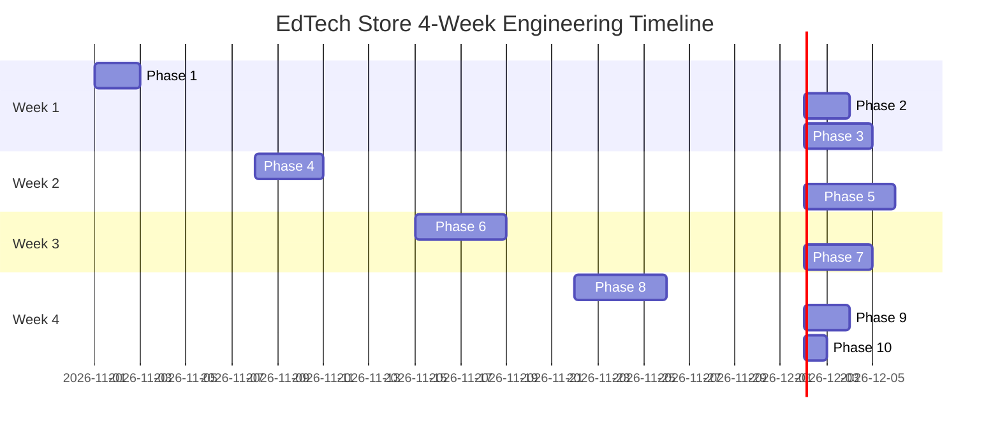

# 06. Development Phases & Implementation Roadmap

This document breaks down the development lifecycle into 10 structured phases, details key tasks and deliverables, and outlines the suggested 4-week execution timeline.

---

## 📅 Suggested 4-Week Schedule

> **Priority Strategy**: Complete and test all backend business logic, database constraints, and payment idempotency before investing significant effort into frontend styling.

---

## 🚀 Detailed Phase Breakdown

### Phase 1 – Project Foundation
- **Tasks**:
  1. Create separate `backend/` and `frontend/` directories.
  2. Set up Python virtual environment (`venv`).
  3. Install Django, Django REST Framework, and MySQL connector (`mysqlclient`).
  4. Create MySQL database and configure `DATABASES` settings.
  5. Set up `.env` parsing with `python-dotenv`.
  6. Initialize Django apps (`accounts`, `catalog`, `products`, `orders`, `payments`, `entitlements`).
- **Deliverable**: Running Django backend connected to MySQL with verified migration pipeline.

---

### Phase 2 – Authentication & Authorization
- **Tasks**:
  1. Implement Custom User model with `STUDENT` and `ADMIN` roles.
  2. Configure password hashing using **Argon2** or **bcrypt**.
  3. Build registration, login, token refresh, and logout endpoints.
  4. Configure JWT authentication with refresh rotation or HTTP-only cookies.
  5. Implement DRF permission classes: `IsStudent`, `IsAdminUser`.
  6. Apply rate limiting on authentication routes to prevent brute-force attacks.
- **Deliverable**: Secure authentication system with enforced role-based API permissions.

---

### Phase 3 – Catalogue Management
- **Tasks**:
  1. Build models and migrations for `Board`, `Class`, `Subject`, `Chapter`, and `Material`.
  2. Implement admin CRUD APIs for each catalogue tier.
  3. Implement public/student read-only endpoints for catalogue navigation.
  4. Build keyword search API across subjects and chapters.
  5. Create file upload handling for PDF study notes (stored securely in internal media folder).
  6. Support setting `is_free_sample = True` for one chapter per subject.
- **Deliverable**: Complete catalogue management APIs with role-restricted administrative endpoints.

---

### Phase 4 – Product & Pricing Engine
- **Tasks**:
  1. Implement `Product` and `Price` models supporting all 6 product types.
  2. Build inclusion resolver (what chapters/subjects a product encompasses).
  3. Implement ownership check API (determining if user already owns content).
  4. Implement overlapping purchase prevention logic.
  5. Implement upgrade credit calculation formula for Subject Packs.
  6. Implement pass validity logic (30-day/365-day duration and renewal stacking).
  7. Implement Coupon validation (flat vs %, date check, usage counters).
  8. Implement 18% inclusive GST split engine.
- **Deliverable**: Pure Python business logic engine thoroughly tested with unit tests.

---

### Phase 5 – Cart & Order Management
- **Tasks**:
  1. Create cart validation API endpoint (`/api/v1/cart/validate/`).
  2. Recalculate all cart prices on the server from raw database prices (never trust frontend).
  3. Apply valid coupons and compute upgrade deductions per item.
  4. Build Order and OrderItem creation endpoint (`/api/v1/orders/create/`).
  5. Save order with `status = 'PENDING'` and initiate a corresponding Razorpay order.
- **Deliverable**: Tamper-proof cart and order generation APIs.

---

### Phase 6 – Razorpay Payment Integration
- **Tasks**:
  1. Configure Razorpay Python SDK with `RAZORPAY_KEY_ID` and `RAZORPAY_KEY_SECRET`.
  2. Build `/api/v1/payments/verify/` to validate checkout modal signatures using HMAC-SHA256.
  3. Build `/api/v1/payments/webhook/` to handle `payment.captured` and `payment.failed`.
  4. Verify `X-Razorpay-Signature` against raw request bytes using `RAZORPAY_WEBHOOK_SECRET`.
  5. Implement dual-path idempotency: verify order amount and ensure exactly-once fulfillment.
  6. Record every payment attempt in `payments` and webhook payload in `webhook_events`.
- **Deliverable**: Battle-tested, idempotent payment processing flow for Razorpay Test Mode.

---

### Phase 7 – Entitlements & Protected Content Delivery
- **Tasks**:
  1. Build `Entitlement` provisioning service triggered upon verified payment.
  2. Grant lifetime entitlements for chapters, subjects, and bundles.
  3. Grant time-bound entitlements for monthly/annual class passes.
  4. Build protected PDF streaming endpoint (`/api/v1/materials/{id}/stream/`).
  5. Verify user entitlements before serving files; return HTTP 403 on locked content.
  6. Build manual grant/revoke endpoints for admins with mandatory audit logging.
- **Deliverable**: Secure entitlement gateway protecting paid educational assets.

---

### Phase 8 – React Frontend Development
- **Student Portal**:
  1. Authentication: Sign up, login, profile view.
  2. Catalog: Board -> Class -> Subject -> Chapter hierarchy browser with search bar.
  3. Product Page: Display price, inclusions, duration, and dynamic state (`Buy` / `Owned` / `Upgrade`).
  4. Cart & Checkout: Item list, coupon code input, 18% GST breakdown, and Razorpay Checkout modal.
  5. My Library: Active courses, notes, and countdown timers for time-bound passes.
  6. In-Browser PDF Viewer: Clean, responsive PDF reader streaming from protected backend API.
  7. Order History: Printable HTML/PDF invoice summary.
- **Admin Portal**:
  1. Hierarchy Editor: CRUD for boards, classes, subjects, and chapters.
  2. Material Manager: Upload PDFs and toggle free sample flags.
  3. Pricing & Product Manager: Set and modify product types and prices.
  4. Order Log: Filterable table of orders and payment attempts by status and date.
  5. Analytics Dashboard: Daily revenue, top-selling items, and active pass counts.
- **Deliverable**: Responsive React + TypeScript frontend fully integrated with DRF backend.

---

### Phase 9 – Automated Testing Suite
- **Tasks**:
  1. Configure `pytest` and `pytest-django`.
  2. Write unit tests for price calculation, upgrade credit floor, coupon limits, and GST split.
  3. Write integration tests for HMAC-SHA256 signature verification (valid vs tampered).
  4. Write idempotency tests for duplicate webhook events.
  5. Write access control tests verifying HTTP 403 when students access locked PDFs or admin routes.
  6. Write pass extension tests verifying early renewal adds to old expiry date.
- **Deliverable**: Comprehensive test suite runnable with a single command (`pytest`).

---

### Phase 10 – Final Submission & Demo Video
- **Tasks**:
  1. Audit GitHub repository: clean commits, no secrets committed, `.env.example` in place.
  2. Document startup and seed commands in `README.md`.
  3. Record 5-minute screen recording walking through the 5 mandatory scenarios.
  4. Prepare for 45-minute live technical walkthrough.
- **Deliverable**: Production-ready GitHub repository and demonstration video.
